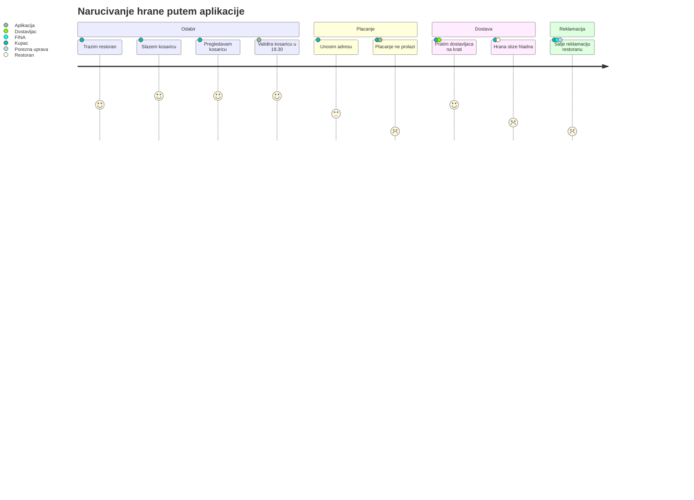
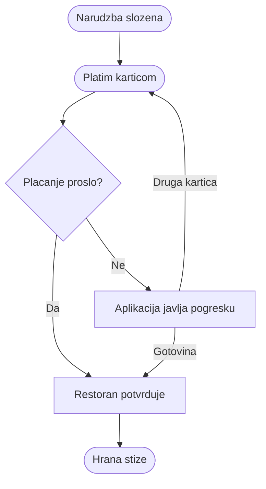
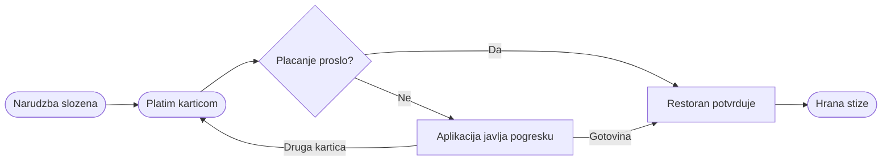
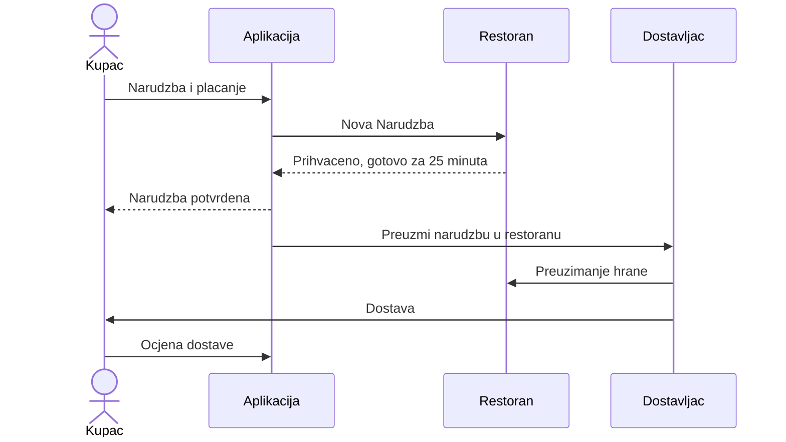

#Današnja lekcija

---

---

---

---
```mermaid
flowchart TD
  A([Datoteka je u polju za predaju]) --> B[Kliknite spremi promjene]
  B --> C{Status je predano?}
  C --> |Da| K([Kraj: zadatak je predan])
  C --> |Ne, piše Skica| D["Kliknem Predaj zadatak (Submit assignment)"]
  D --> E{Traži se potvrda?}
  E --> |Da| F[Označim izjavu i potvrdim]
  F --> C
  E --> |Ne| C 
  ```